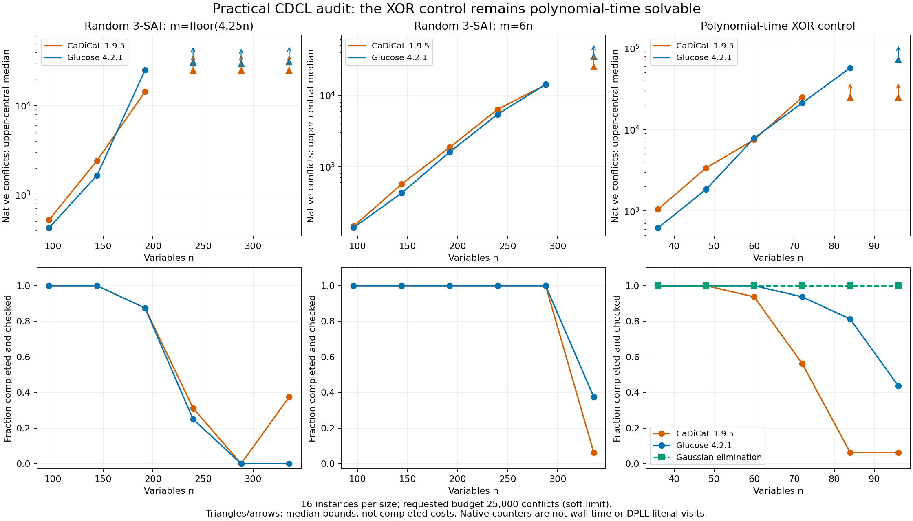

# 続編：実用CDCLでも難しさは残るか

2026-11-07 JST。前回の[有限サイズ実験](sat_scaling.md)を、
節学習・再始動を備えた外部ソルバーへ拡張した。
**前回未完了だった22件を含む416件は、二つのソルバーがすべて判定した。
一方、大きい入力では再び未完了例が増えた。**
その現象は多項式時間で解けるXOR対照にも現れるため、
P≠NPの一般下界や確率へ読み替えることはできない。

これは新たな実測結果であり、P vs NPの完全証明ではない。
前の単純なDPLLの曲線を、SATそのものの固有の計算量として扱う案は採用しない。
完全証明を最終目標としつつ、実験を算法・入力分布・推論能力の比較に使う。

## 1. 条件と検証範囲

[実行前のプロトコル](cdcl_protocol.md)に従った。
PySAT `1.9.dev21` から **Glucose 4.2.1** (`g42`) と
**CaDiCaL 1.9.5** (`cadical195`) を呼び出し、各入力に新しいインスタンスを使った。
既定設定に証明ログを有効化し、25,000 conflictsのソフト予算を要求した。
最新版・最高性能のソルバーを代表するという主張はしない。

* 同一入力比較：前回の416個のCNFをseedから再生成し、SHA256一致を確認。
  変数・節の順序も同じ。二つのソルバーで計832回。
* 拡大比較：各サイズ16例、乱数3-SATの二密度について96〜336変数、
  XOR対照について36〜96変数。新たな288式、計576回。
* 合計1,408回の測定。SAT 267回、UNSAT 980回、UNKNOWN 161回。
  SATは元のCNFへの代入で検算し、UNSATは別実装の`drat-trim`で証明を検査した。
  UNKNOWNは判定失敗を隠さず残した途中結果であり、UNSATとは異なる。
* 本測定とは別に、3変数の真理値全列挙と偶奇の正負対照による516回の検査、
  偽のUNSAT証明を検査器が拒否する検査を行った。
* XORの224式は、CNFから方程式を取り出す既存のGaussian算法でもすべて検証した。

`drat-trim`は[固定コミットの無改変ソースとMITライセンス](../third_party/drat_trim/README.md)
を保存し、別途Cコンパイラでビルドした。
Python・コンパイラ・ネイティブソルバーのハッシュも記録した。
証明検査は独立したソフトウェアによるもので、Leanのカーネル検証ではない。
ソルバー同士が同じ答えを返したことだけを検証の根拠にはしていない。

## 2. 同じ416式では、前回の探索上の限界が解消した

| ソルバー | SAT | UNSAT | UNKNOWN | 最大conflicts |
|---|---:|---:|---:|---:|
| Glucose 4.2.1 | 101 | 315 | 0 | 979 |
| CaDiCaL 1.9.5 | 101 | 315 | 0 | 1,342 |

両方とも、前回のDPLLが予算切れだった22件を含めて完了した。
前回はリテラル検査、今回はconflictsを数えているため、
両者の数字を割った値を速度向上率としては扱わない。

CDCLは矛盾から得た節を保存して別の分岐でも使い、再始動後もその情報を利用できる。
ただし、変数選択・伝播実装・前処理なども同時に変わっている。
今回の比較は、それらを含む実装全体の比較であり、節学習だけの因果効果を
測った除去実験ではない。完了した一群が小さいからといって、多項式上界も導けない。

## 3. 大サイズでは、節学習を備えていても未完了例が増えた

代表的な拡大サイズにおける**未完了件数／16件**を示す。

| 入力分布 | 変数数 | Glucose | CaDiCaL |
|---|---:|---:|---:|
| ランダム3-SAT、4.25n節 | 192 | 2/16 | 2/16 |
| 同上 | 240 | 12/16 | 11/16 |
| 同上 | 288 | 16/16 | 16/16 |
| 同上 | 336 | 16/16 | 10/16 |
| ランダム3-SAT、6n節 | 288 | 0/16 | 0/16 |
| 同上 | 336 | 10/16 | 15/16 |
| 多項式時間で解けるXOR対照 | 72 | 1/16 | 7/16 |
| 同上 | 84 | 3/16 | 15/16 |
| 同上 | 96 | 9/16 | 15/16 |

XOR対照はGaussian消去で全例完了する。したがって、複数の実用CDCLが
同じ入力で苦戦することだけでも、全算法の下界には進めない。

**表をソルバーの速度順位として読むこともできない。**
同じ25,000を指定しても、予算確認の間隔が異なり、Glucoseの未完了例には
100,000 conflictsまで進んだものがある。完了例が25,000を超えることもある。
実際に消費した計算が等しくないため、完了率の違いだけでは優劣を判定しない。
ソルバー内部のconflicts・propagationsなどのカウンタも総ビット時間ではない。

各サイズ16例は別々に生成した入力である。
例えばCaDiCaLの4.25n節で288変数は全例未完了、336変数は6例完了したが、
これは同一の式を拡大したら容易になったという比較ではない。
SAT/UNSAT比率と標本のばらつきも影響する。最悪時の単調な増加曲線ではない。



[SVG](../results/cdcl_audit.svg)・[全測定値](../results/cdcl_audit.json)。
上向き三角と矢印は未確定な代表値の下限であり、飽和した計算量ではない。
横ばいの探索コストだと誤読しないよう、未確定点を実線では接続していない。

## 4. 今回は「指数型が勝った」という当てはめを出さない

プロトコルでは、全サイズで中央の代表値が正確に求まる系列だけを、
多項式型・中間型・指数型の比較に使うと定めた。
今回は六系列すべてで少なくとも一サイズの代表値が未確定になったので、
**六系列とも曲線の型を選ばなかった。** 完了した例だけで当てはめ直してはいない。

予算値が実行ごとに異なるため、代表値の扱いも前回より一般化した。
完了した観測値 `c_i` の可能区間は `[c_i,c_i]`、
未完了なら `[c_i,+infinity)` とする。
各下端を昇順に並べた9番目を `L`、上端の9番目を `U` とすると、
真の9番目の値は `[L,U]` に入る。これは順序統計量が各成分について単調なためである。
`L=U` の場合だけ正確な代表値とする。無限上端はJSONの`null`で表す。
この方法なら、異なるところで停止した例を除外する偏りを避けられる。

観測としては、4.25n節で両ソルバーが192〜288変数にかけて苦戦し、
6n節ではより大きいサイズまで完了できた、と言える。
多項式か指数時間かの漸近的判定、ETHの検証、P≠NPの確率評価にはならない。
明示的な尤度モデルや事前分布を置かない「P≠NPが何%」は報告しない。

## 5. なぜXOR対照が重要か、次の判断をどう変えるか

XOR対照の矛盾の理由は全サイズで分かっている。
各辺変数がちょうど二つの頂点方程式に現れるため、全式をGF(2)上で足すと
左辺は0となり、右辺の電荷の総和は1になる。
元のCNFの四節パターンからこの方程式を多項式時間で回復できる。
この認識と消去の[計算量の議論](sat_scaling.md#3-対照例が示す結論の限界)は変わらない。

**難しさが節学習を加えても残ることと、問題に多項式算法が存在しないことは別である。**
この区別は今回、実用ソルバー二つと、同じ入力への明示的な多項式算法で確認できた。
「さらに何種類かのソルバーを試せばP≠NPの証拠になる」という進め方は採用しない。
得られた対照は、今後の証明候補が算法への依存を取り違えていないかを調べるために残す。

完全証明へ進むには、P=NP側なら任意の3-CNFへ適用できる多項式の構造処理、
P≠NP側なら未知の算法も含めた下界の論証が必要である。
現時点でその核心は得られていない。実験の規模を増やすだけで量化の差を埋めたとは扱わない。
**今回の結論は、複数の算法でも残る有限の探索困難と、代数的に消える困難の区別まで。
完全証明も、P vs NP全体の方向の判定も未達である。**

## 6. 再現と依存関係

既定の標準ライブラリだけの検証に、新しい補助処理の7テストを追加した。
外部ソルバーの実行は、既定の`reproduce.py`とは分離している。
既定検証の成功が、外部ソルバーの再実行を意味することはない。

```sh
# 外部算法の比較を再実行する場合だけ必要
python3 -m venv .venv
.venv/bin/python -m pip install -r requirements-cdcl.txt
.venv/bin/python scripts/run_cdcl_audit.py \
  --out-dir reproduced/cdcl --check results/cdcl_audit.json

# 通常の標準ライブラリだけの検証
python3 scripts/reproduce.py --out-dir reproduced --check

# 図の再作成。matplotlibはこの任意の処理だけで使用
MPLCONFIGDIR=/tmp/pnp-lab-matplotlib XDG_CACHE_HOME=/tmp/pnp-lab-cache \
  python3 scripts/plot_cdcl_audit.py
```

`run_cdcl_audit.py`は、保存したCソースのハッシュを確認して検査器をビルドし、
全入力の再生成、SAT割当検査、UNSAT証明検査、結果比較を行う。
ローカル実行にはPython 3.12.14、gcc 14.2.0、x86_64 Linuxを使用した。
完全一致の比較にはコンパイラ・ネイティブバイナリのハッシュなども含めるため、
異なる環境では、数学的な答えが一致しても同一実行記録としては不一致になる場合がある。
環境の違いを無視してチェックを通すことはしない。

入力CNF・証明・検査ログは`reproduced/cdcl/certificates/`に残る。
保存用のJSONには各式のseed・ハッシュ、証明のハッシュ・行数・検査結果を記録する。
新しい一般下界やLean定理は追加していない。

参照：実装の出典は[PySAT公式リポジトリ](https://github.com/pysathq/pysat)と
[固定したdrat-trim](https://github.com/marijnheule/drat-trim/tree/2e3b2dc0ecf938addbd779d42877b6ed69d9a985)。
算法や検査器の新規性を主張するものではない。
