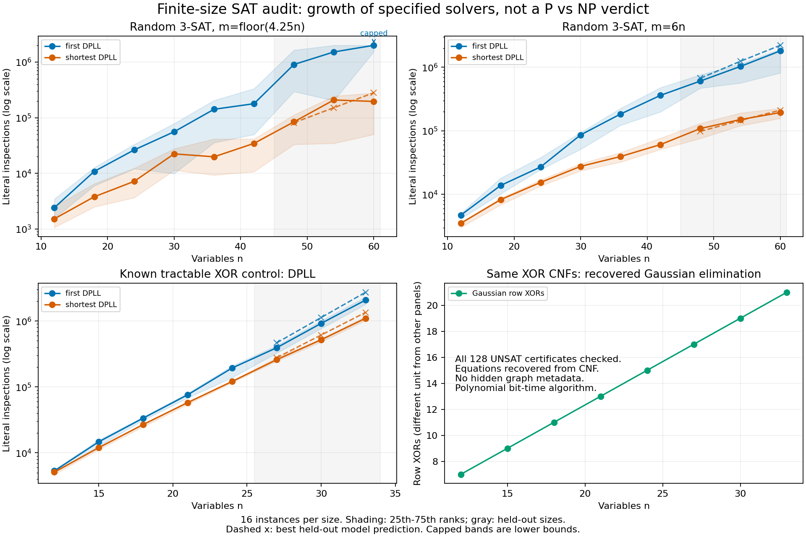

# 新戦略：SATの有限サイズ傾向を、算法への依存まで含めて測る

実用ソルバーによる続編は[CDCL比較](cdcl_audit.md)。以下は初回実験の記録。

2026-11-07 JST。完全証明を最終目標として維持し、ユーザーが追加した
「どちらに寄るかの傾向」という目的について、再現可能な実験を行った。
ここでの近似は**特定の算法の探索量の増加曲線**を意味する。
P=NP／P≠NPの真偽に対する確率や、完全証明への達成率ではない。

**結果：一部の探索曲線は指数型に寄ったが、P vs NP全体の方向は判定できない。**
多項式時間で解ける対照問題にも、同じ指数型の曲線が現れた。
したがって「指数型に見えたからP≠NPを支持する」という判定規則は採用しない。
以前の固定行列の案や、停止したMCSPの下界案は再開していない。

## 1. 何を変えたか

一つの表示や算法の限界を一般計算の下界へ広げる方針から、
**算法と入力分布を変えたときに何が変わるかを測り、候補を選別する方針**に切り替えた。
これは実験研究の方針であり、現時点で生き残った完全証明の論証ではない。

[実行前に固定した条件](sat_scaling_protocol.md)に従い、次を比較した。

* 3-CNFを疑似乱数で生成。節数は `floor(4.25n)` または `6n`。
  各節の変数は異なり、重複節はない。サイズごと16例、12〜60変数。
* 単位伝播を行う完全なDPLL探索を二通り実装。
  `first` は最小番号の変数、`shortest` は最短の残余節で頻出する変数を分岐対象に選ぶ。
  学習や再始動を持たず、現代の高性能SATソルバーの代表ではない。
* 線形代数で解ける対照例として、連結3正則グラフの各頂点にXOR制約を置いた。
  電荷の総和が奇数なので全体はUNSAT。制約は通常の3-CNFに展開して探索器へ渡す。
  12〜33変数、各サイズ16例。
* 小さいサイズで、多項式型 `A n^b`、中間型 `A 2^(b sqrt(n))`、
  指数型 `A 2^(bn)` を当てはめ、大きいサイズで予測誤差を比べる。
  実際の回帰は `log2(work+1)` に対して行うため、上式の応答には厳密には `+1` が付く。

主要指標は伝播・分岐中の**リテラル検査回数**。これは機械の総実行時間ではない。
この三族では入力長は `O(n log n)` であり、`n` と入力長での多項式性は同値だが、
今回の回帰を最悪時のビット計算量の証明へ置き換えることはできない。

## 2. 得られた傾向

中央の代表値は16例を小さい順に並べた**9番目**。
各行のモデルは、小サイズだけで合わせた曲線が、大サイズのこの代表値を
どれだけ予測したかで比較している。単位は `log2(work+1)` のRMSEで、小さいほどよい。

| 入力分布・探索法 | 多項式型 | 中間型 | 指数型 | この範囲で最も合った型 |
|---|---:|---:|---:|---|
| ランダム3-SAT、4.25n節、shortest | 1.249 | 0.708 | **0.403** | 指数型 |
| ランダム3-SAT、6n節、first | 0.630 | **0.244** | 1.253 | 中間型 |
| ランダム3-SAT、6n節、shortest | 0.539 | **0.114** | 0.642 | 中間型 |
| 多項式時間で解けるXOR対照、first | 0.929 | 0.357 | **0.318** | 指数型 |
| 多項式時間で解けるXOR対照、shortest | 0.883 | 0.368 | **0.227** | 指数型 |

4.25n節の `first` は、60変数で16例中9例が200万回の予算を使い切った。
代表値が確定していないため、規定どおりその系列の曲線当てはめを行わなかった。
未完了例を落として平均・代表値を計算することはしていない。
一部の他系列にも未完了例はあるが、その場合は未完了例より下の9番目が
完了例であることを確認できたサイズに限って、代表値を正確な値として使っている。

4.25n節の `shortest` の代表値は12変数で1,520回、60変数で196,076回だった。
指数型の係数は `log2(work+1) ≈ 9.152 + 0.149n` だが、
最小の二サイズを学習から外すと傾きは0.110に変わる。
6n節では、同じ操作により `first` の最良モデルが中間型から多項式型へ、
`shortest` では中間型から指数型へ変わった。
**これらの係数や型を、無限に続く増加率として固定する根拠はない。**

16例しかないこと、満たせる式の割合がサイズとともに変わること、
holdoutが三サイズだけであることも制限になる。
分布ごとのSAT/UNSAT/UNKNOWN数と四分位の広がりを保存した。
区間は標本のばらつきであり、母集団の信頼区間ではない。
大サイズはモデル比較にも使用しており、選択後の性能を確認する第三の未使用データはない。
モデル選択の有意性検定やP vs NPの事後確率は計算していない。
ノード数の要約は途中終了した探索も含む観測値であり、完走時のノード数とは限らない。



[SVG図](../results/sat_scaling.svg)・[生の測定値と当てはめ](../results/sat_scaling.json)。
図中の破線は最良モデルの大サイズ予測、灰色の領域は学習に使わなかったサイズ。
打ち切られた曲線・四分位は下限として表示している。

## 3. 対照例が示す、結論の限界

XOR対照の `shortest` は、12変数で5,096回、33変数で1,101,408回の
リテラル検査を要した。指数型の予測が多項式型よりよく合った。
しかし、**全く同じCNF**からXOR方程式を読み取り、Gaussian消去で解くと、
128例すべての矛盾を検証できた。観測された行XOR回数は7〜21回だった。
リテラル検査と行XORは異なる単位なので、この数字の比を速度比として扱わない。
行は入力長に応じたビット幅を持ち、読み取り・認識・証明書の操作も必要になる。

ここで多項式時間性は、曲線を見て推測したものではない。次の直接の議論による。

1. 同じ3変数上の節を集め、ちょうど四つの異なる符号パターンがあるかを確認する。
   各節が禁止する割当の偶奇が同じなら、その四つは一つの偶奇類全体である。
   四節の連言は反対の偶奇を要求するXOR方程式に**同値**になる。
   これで入力全体を覆えた場合だけ、この認識を使う。
2. `m` 本・`n` 変数の方程式を消去する。一つの行は高々 `min(m,n)` 個の
   ピボットで消去される。各行と元の行の選択記録は `O(n+m)` ビットなので、
   `O(m min(m,n)(n+m))` を含む多項式のビット演算で済む。
   解があれば逆代入し、なければ元の行のXOR和 `0=1` を出す。
3. 対照族では各辺変数がちょうど二つの頂点方程式に現れる。
   全行を足すと左辺は0、右辺は1。これが全サイズでの不充足の証明になる。

認識はCNFそのものだけを読み、生成時のグラフや電荷を秘密のヒントとして使わない。
認識できない一般CNFについて結論を返す手順ではない。
これらは標準的なDPLL・偶奇符号化・線形代数の再構成であり、新規算法の優先権主張ではない。

この例により、今回採用した「指数型が最も合う」という判定は、
**多項式時間で解けるクラスを区別できない**ことが実測と理論の両方から分かる。
一般SATで同じ判定が出たことだけからP≠NPへ推論することはできない。

## 4. 完全証明との接続をどう扱うか

有限のデータだけから、無条件でP=NPまたはP≠NPを選ぶ手順はここにはない。
例えば、有限集合のSATの答えはプログラムに表として埋め込める。
その集合内では直ちに答え、それ以外では全探索する正しいSAT算法を作れるが、
それが速い有限集合は全入力での多項式時間性を意味しない。
逆に、仮に多項式時間のSAT算法が存在しても、有限個の入力でだけ任意の有限な
待ち時間を加えた算法は依然として多項式時間である。有限集合での遅さは排除にならない。
特定算法の下界を示しても、未知の別算法は排除できない。

今後の実験上の採用基準を次に変更する。

* 急な増加曲線が出たことより、**どの推論能力を加えると崩れるか**を優先する。
  今回はXORの認識・消去で崩れた。学習・再始動を備えた外部ソルバーでは未検証。
* P=NP側へ進むには、見つけた構造処理を任意の3-CNFへどう適用するかと、
  全処理の一様な多項式上界を示す。対照族を解けたことでは代用しない。
* P≠NP側へ進むには、複数の実装が苦戦することから一歩進み、任意の算法へ
  適用できる下界の論証を要する。有限個の算法を追加しても、その量化は埋まらない。

現状は**局所的には指数型・中間型の探索傾向、P vs NP全体では未判定**。
完全証明も、そのまま完成へ延ばせる未検証の核心も得られていない。
「P≠NPの確率90%」のような数値は出さない。
今回得られたのは、研究候補の選別をより誤りにくくする測定と対照である。

## 5. 検証と再現

416個のCNFに対して二通りずつ、計832回のDPLL探索を実施。
810回は完了し、22回はUNKNOWNとして記録した。全完了結果について、
SAT割当の代入または独立したUNSAT証明書の再生を行った。
加えて128回の代数的判定について、元の行のXOR和を検算した。
これらは新しい一般下界の検証件数ではない。

UNSAT証明書は、単位伝播の根拠となる元の節、未確定変数への二分岐、
葉で偽になった元の節からなる。検査器はSAT探索器を呼ばない。
証明書全体は実行中に生成・再生し、生データには検査済みフラグを保存する。
各CNFのseedとSHA256により入力を再生成できる。

新規9テストには、3変数の全八種の3節からなる全256部分集合との真理値照合、
混合幅の小CNF、証明書の改ざん、予算切れ、偶奇認識の正誤、
Gaussian消去と全列挙の照合、打ち切りの扱い、既知の合成曲線を含む。
通常の再現スクリプトに統合した。今回Leanファイルは追加・変更していない。

```sh
PYTHONPATH=src python3 -m unittest discover -s tests -p test_sat_scaling.py -v
python3 experiments/sat_scaling.py --out-dir reproduced
python3 scripts/reproduce.py --out-dir reproduced --check
# 図のみ任意依存 matplotlib を使用。実験・検証本体は標準ライブラリだけ。
MPLCONFIGDIR=/tmp/pnp-lab-matplotlib XDG_CACHE_HOME=/tmp/pnp-lab-cache \
  python3 scripts/plot_sat_scaling.py --report reproduced/sat_scaling.json --out-dir reproduced
```
